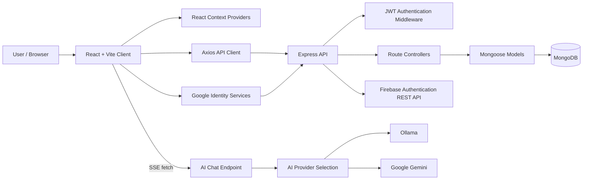
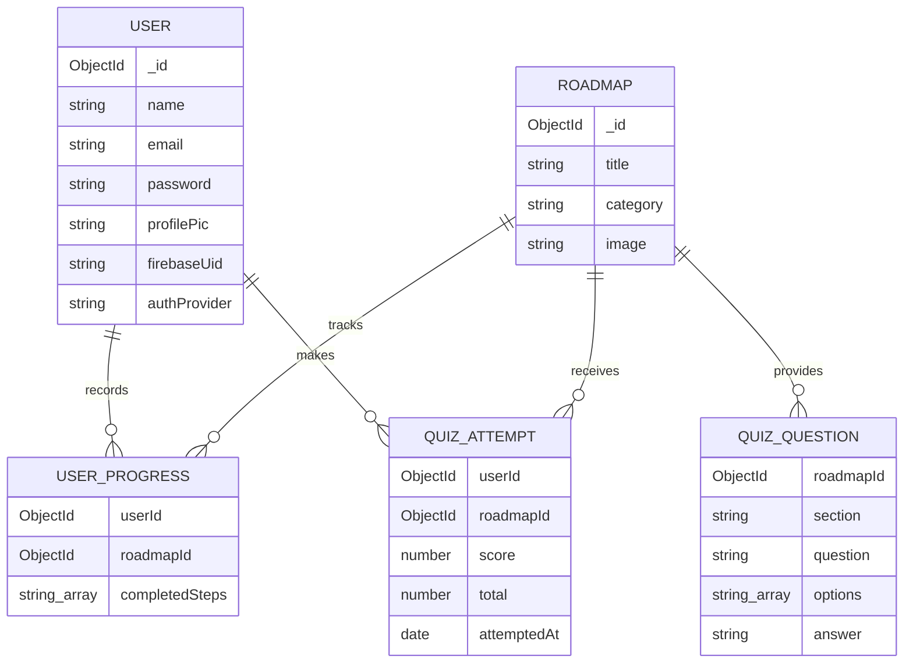
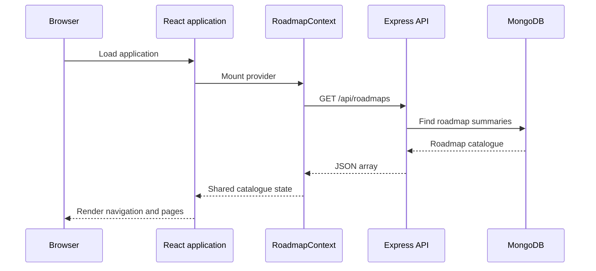
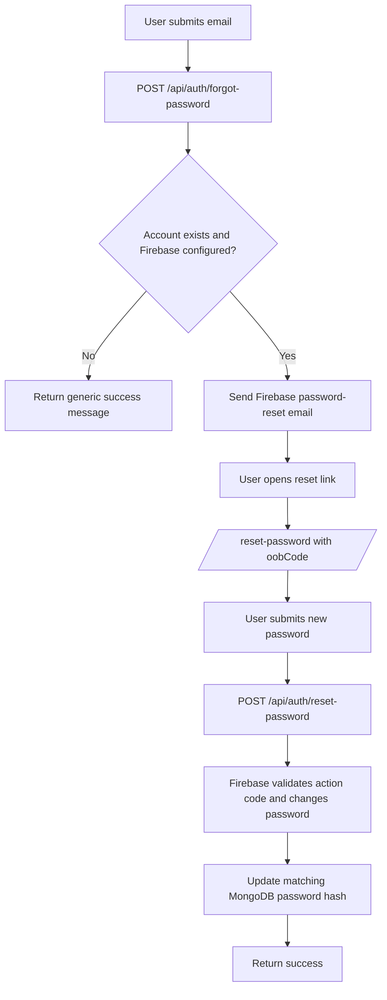
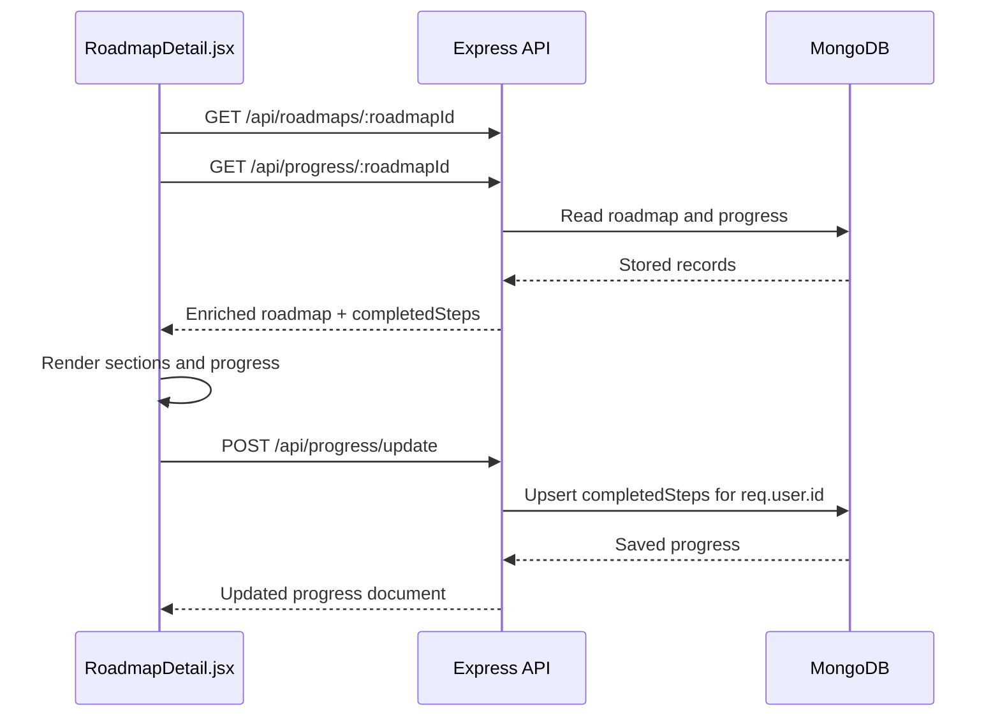
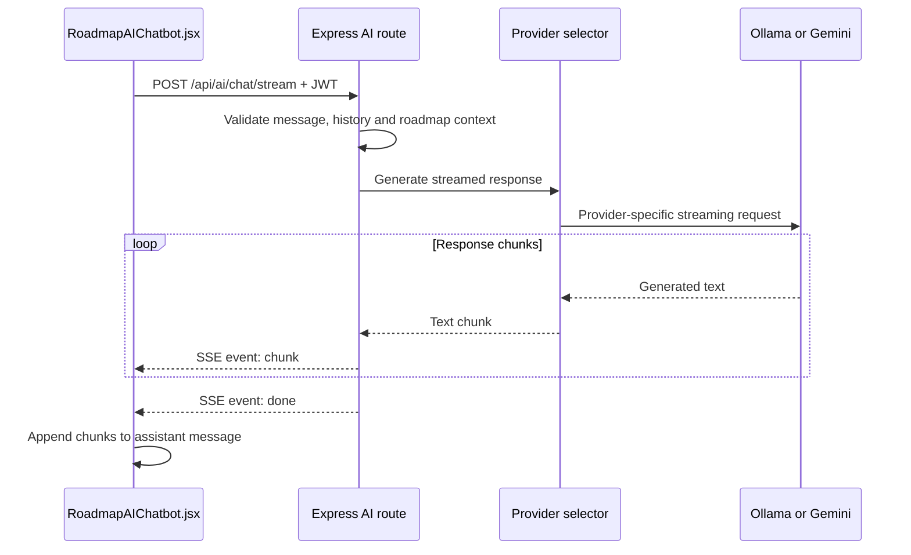
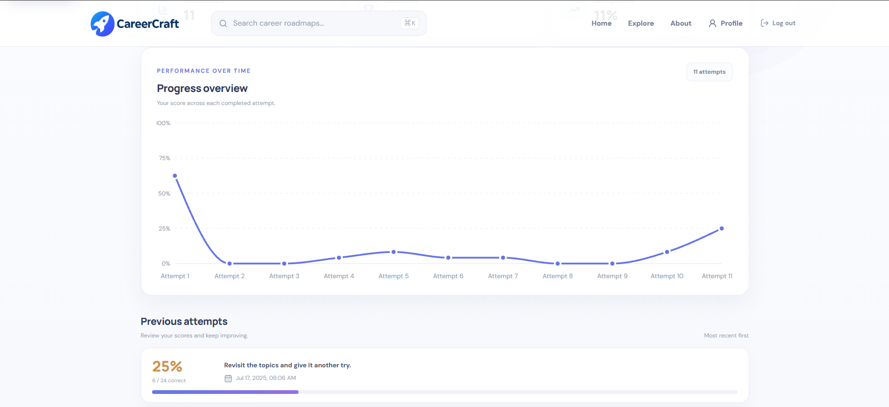

# CareerCraft

**A full-stack career-roadmap and learning-progress platform built with React, Express, MongoDB, and AI-assisted guidance.**

CareerCraft helps learners choose a technology career path, work through structured learning milestones, save their progress, test their understanding with timed quizzes, review quiz performance, and ask questions about the roadmap they are following.

The repository is organized as two applications:

- `client/` — the React single-page application, built with Vite.
- `server/` — the Express API, backed by MongoDB and Mongoose.

The backend uses CareerCraft JWTs for protected API requests. Firebase Authentication is integrated for Google sign-in and password-reset workflows, while the AI assistant can use Ollama or Google Gemini.

---

## Table of contents

- [Product capabilities](#product-capabilities)
- [Technology stack](#technology-stack)
- [System architecture](#system-architecture)
- [Repository structure](#repository-structure)
- [Frontend architecture](#frontend-architecture)
- [Backend architecture](#backend-architecture)
- [Database design](#database-design)
- [Application flows](#application-flows)
- [API reference](#api-reference)
- [AI assistant configuration](#ai-assistant-configuration)
- [Environment variables](#environment-variables)
- [Local development setup](#local-development-setup)
- [Build and quality checks](#build-and-quality-checks)
- [Deployment overview](#deployment-overview)
- [Security and implementation notes](#security-and-implementation-notes)
- [Screenshots](#screenshots)
- [Current scope and planned work](#current-scope-and-planned-work)
- [Contributing](#contributing)
- [Maintainer](#maintainer)

---

## Product capabilities

### Career-roadmap discovery

- Browse the available career-roadmap catalogue.
- Search roadmaps by title and category from the navigation bar.
- Filter the Explore dashboard by category and search text.
- Open a roadmap to view its sections, steps, descriptions, and learning resources.
- See milestone completion at roadmap and section level.

### Learning progress

- Mark a roadmap step as complete or incomplete.
- Persist completed step titles against the signed-in user and roadmap in MongoDB.
- Load saved progress when returning to a roadmap.
- View the number of roadmaps started and completed on the dashboard.
- Update the page immediately when a step is toggled; restore the previous state if the save request fails.

### Quizzes and performance history

- View quiz instructions and question count before starting.
- Answer multiple-choice questions with a 30-second timer per question.
- Pause and resume the timer, skip questions, and move forward through the quiz.
- View the final score and review selected answers against correct answers in the active quiz session.
- Save each quiz result to the database.
- Review previous attempts for a roadmap, including total attempts, best score, average score, and a score trend chart.

### AI roadmap assistant

- Open the chatbot from a roadmap detail page.
- Ask questions in the context of the roadmap currently being viewed.
- Include recent conversation history with each request.
- Stream generated response chunks into the chat interface.
- Use Ollama locally, Gemini directly, or automatic Ollama-to-Gemini fallback.

### Accounts and profiles

- Create an account with name, email, and password.
- Sign in with email and password.
- Sign in with Google when Firebase and Google Identity Services are configured.
- Request a password-reset email and submit a new password using the Firebase action code.
- Edit the display name and profile image.
- Remove the profile image.
- Permanently delete the account and its CareerCraft progress and quiz-attempt records.

### Smart learning resources

Roadmap detail responses are enriched on the server with topic-aware recommendations from a curated resource catalogue. The recommender scores resource tags against a step title, step description, and roadmap category. Existing roadmap URLs are retained as fallback resources and duplicate URLs are removed.

---

## Technology stack

| Area | Technology | Role in CareerCraft |
|---|---|---|
| Frontend runtime | React 19 | Component-based user interface |
| Frontend tooling | Vite 7 | Development server and production build |
| Routing | React Router 7 | Client-side routes and protected pages |
| Styling | Tailwind CSS 4 and project CSS | Utility styling and responsive page/component layouts |
| HTTP client | Axios | REST requests and JWT request interceptor |
| Motion | Framer Motion | Page and component transitions |
| Charts | Recharts 3 | Quiz-performance trend chart |
| Icons | Lucide React and React Icons | Interface icons |
| Notifications | React Hot Toast | Success and error feedback |
| Backend runtime | Node.js 24.x | JavaScript server runtime |
| API framework | Express 5 | REST endpoints and middleware |
| Database | MongoDB | Persistent application data |
| ODM | Mongoose 8 | MongoDB schemas, models, and queries |
| Password hashing | bcryptjs | Local password hashing and verification |
| Application sessions | JSON Web Tokens | Signed bearer tokens for protected APIs |
| External authentication | Firebase Authentication REST API | Google identity exchange and password-reset operations |
| AI providers | Ollama and Google Gemini | Roadmap-aware assistant responses |

Versions above reflect the package manifests in this repository. Consult `client/package.json` and `server/package.json` for the exact dependency ranges.

---

## System architecture

### High-level view



### Request lifecycle

1. The browser loads the Vite-built React application.
2. `main.jsx` mounts the application inside the authentication, progress, and roadmap context providers.
3. A page or context requests data through `client/src/services/api.js` (the AI streaming chat uses `fetch` so it can read the response stream).
4. The Axios request interceptor reads the current CareerCraft JWT from `localStorage` and adds it as `Authorization: Bearer <token>`.
5. Express receives the request. Protected routes run `requireAuth`, which verifies the JWT and places the decoded user ID on `req.user`.
6. The route calls its controller. Controllers read or update MongoDB through Mongoose models.
7. The API returns JSON, except for the AI streaming route, which returns Server-Sent Events (SSE).
8. React updates page state and displays the resulting data or an error notification.

### Backend connection behavior

MongoDB is connected lazily through `connectDB()` for the roadmap, auth, progress, and quiz route groups. A module-level connection flag avoids reconnecting for every request in the same running instance. The AI route group is mounted separately and does not require a MongoDB connection for chat generation.

The Express application accepts JSON request bodies up to 1 MB and enables CORS for localhost, the configured production frontend URL, and the `FRONTEND_URL` environment variable when supplied.

---

## Repository structure

```text
CareerCraft/
│
├── client/                              # React + Vite frontend
│   ├── public/
│   │   ├── roadmaps/                    # Local roadmap thumbnail assets
│   │   ├── logo.png
│   │   ├── favicon.png
│   │   ├── hero-illustration.png
│   │   └── about.png
│   │
│   ├── src/
│   │   ├── components/
│   │   │   ├── Navbar.jsx               # Main navigation and roadmap search
│   │   │   ├── Footer.jsx               # Global footer
│   │   │   ├── Layout.jsx               # Shared page shell
│   │   │   ├── ProtectedRoute.jsx       # JWT-presence route guard
│   │   │   └── RoadmapAIChatbot.jsx     # Roadmap-aware streaming chat UI
│   │   │
│   │   ├── context/
│   │   │   ├── AuthContext.jsx          # User and token state
│   │   │   ├── ProgressContext.jsx      # In-memory progress summary state
│   │   │   └── RoadmapContext.jsx       # Roadmap catalogue state and refresh
│   │   │
│   │   ├── pages/
│   │   │   ├── Home.jsx                 # Public landing page
│   │   │   ├── About.jsx                # Public product information
│   │   │   ├── Login.jsx                # Email/password and Google sign-in
│   │   │   ├── Signup.jsx               # Account creation
│   │   │   ├── ForgotPassword.jsx       # Password-reset request
│   │   │   ├── ResetPassword.jsx        # Firebase action-code handler
│   │   │   ├── Dashboard.jsx            # Protected roadmap catalogue
│   │   │   ├── RoadmapDetail.jsx        # Roadmap milestones and resources
│   │   │   ├── QuizInstructions.jsx     # Quiz overview and confirmation
│   │   │   ├── Quiz.jsx                 # Timed quiz and answer review
│   │   │   ├── QuizAttempts.jsx         # Per-roadmap quiz analytics
│   │   │   └── Profile.jsx              # Profile editing and deletion
│   │   │
│   │   ├── services/
│   │   │   ├── api.js                   # Axios instance and JWT interceptor
│   │   │   └── firebaseGoogle.js        # Google Identity Services helpers
│   │   │
│   │   ├── App.jsx                      # Route declarations
│   │   ├── App.css                      # Global/application styling
│   │   ├── index.css                    # Base and responsive styling
│   │   └── main.jsx                     # React entry point and providers
│   │
│   ├── index.html
│   ├── vite.config.js
│   ├── eslint.config.js
│   └── package.json
│
├── server/                              # Express + MongoDB backend
│   ├── controllers/
│   │   ├── authController.js            # Registration, sign-in, profile actions
│   │   ├── roadmapController.js         # Roadmap catalogue and detail
│   │   ├── progressController.js        # Milestone progress persistence
│   │   ├── quizController.js            # Quiz questions and attempts
│   │   └── aiController.js              # Ollama/Gemini chat and SSE streaming
│   │
│   ├── middleware/
│   │   └── authMiddleware.js            # JWT bearer-token verification
│   │
│   ├── models/
│   │   ├── User.js                      # User and authentication metadata
│   │   ├── Roadmap.js                   # Roadmap sections and steps
│   │   ├── UserProgress.js              # User milestone completion
│   │   ├── QuizQuestion.js              # Multiple-choice question bank
│   │   └── QuizAttempt.js               # Saved quiz scores
│   │
│   ├── routes/
│   │   ├── authRoutes.js
│   │   ├── roadmapRoutes.js
│   │   ├── progressRoutes.js
│   │   ├── quizRoutes.js
│   │   └── aiRoutes.js
│   │
│   ├── utils/
│   │   ├── firebaseAuth.js              # Firebase Identity Toolkit calls
│   │   └── resourceCatalog.js            # Curated resource matching
│   │
│   ├── server.js                        # Express app, CORS, DB, route mounts
│   ├── vercel.json                      # Vercel Node server configuration
│   └── package.json
│
├── screenshots/                         # README product screenshots
│   ├── homepage.png
│   ├── roadmap-dashboard.png
│   ├── quiz-module.png
│   └── analytics-dashboard.png
│
├── .gitignore
└── README.md
```

Local `.env` files and `node_modules` directories are intentionally not listed in the source tree above. Do not commit secrets or dependency folders.

---

## Frontend architecture

### Application bootstrap

`client/src/main.jsx` is the React entry point. It mounts the application inside three shared providers:

| Provider | Responsibility | State exposed |
|---|---|---|
| `AuthProvider` | Reads and updates the signed-in user and authentication tokens | `token`, `user`, `login`, `logout`, `loading` |
| `ProgressProvider` | Keeps lightweight progress summaries available between pages | `progressMap`, `setProgressMap`, `updateProgress` |
| `RoadmapProvider` | Loads and shares the public roadmap catalogue | `roadmaps`, `loading`, `error`, `refreshRoadmaps` |

`App.jsx` sets up `BrowserRouter`, the global toast component, and the route tree. `Layout.jsx` supplies the shared navigation, main content region, and footer.

### Frontend route map

| Route | Page | Access |
|---|---|---|
| `/` | Home | Public |
| `/about` | About | Public |
| `/login` | Login | Public |
| `/signup` | Signup | Public |
| `/forgot-password` | Forgot password | Public |
| `/reset-password` | Reset password | Public; expects Firebase `oobCode` query parameter |
| `/dashboard` | Explore dashboard | Protected |
| `/roadmap/:roadmapId` | Roadmap detail | Protected |
| `/quiz/:roadmapId/instructions` | Quiz instructions | Protected |
| `/quiz/:roadmapId` | Timed quiz | Protected |
| `/quiz/:roadmapId/attempts` | Quiz attempt history | Protected |
| `/profile` | Profile | Protected |

`ProtectedRoute.jsx` waits for the authentication context to initialize. If no CareerCraft token is present, it redirects the visitor to `/login`. This is a client-side navigation guard; the backend independently verifies bearer tokens on protected API routes.

### Shared services and state

**Axios service — `services/api.js`**

- Uses `VITE_API_BASE_URL` when configured.
- Defaults to `http://localhost:5000/api` for local development.
- Applies a 20-second request timeout.
- Reads the token from `localStorage` for every request.
- Adds `Authorization: Bearer <token>` when a token exists and removes a stale authorization header after logout.

**Authentication context — `context/AuthContext.jsx`**

- Persists the CareerCraft JWT and public user object in `localStorage`.
- Stores Firebase ID and refresh tokens when supplied by the authentication response.
- Exposes `login()` and `logout()` so pages can update authentication state consistently.
- Clears CareerCraft and Firebase tokens on logout.

**Roadmap context — `context/RoadmapContext.jsx`**

- Fetches `GET /api/roadmaps` when the provider mounts.
- Shares the catalogue with the dashboard and navigation search.
- Supports refresh and aborts in-flight catalogue requests when the provider unmounts.

**Progress context — `context/ProgressContext.jsx`**

- Stores compact `{ completed, total }` summaries keyed by roadmap ID.
- Supports fast UI updates; MongoDB remains the persistent source of truth.

### Page responsibilities

- `Home.jsx` introduces the product and directs new users to signup or existing users to the dashboard.
- `Dashboard.jsx` combines the public roadmap catalogue with the signed-in user's progress summary, category filters, search, and roadmap cards.
- `RoadmapDetail.jsx` loads a complete roadmap and its progress, renders collapsible sections and resources, persists step toggles, and mounts the AI chatbot.
- `QuizInstructions.jsx` checks the available question count, explains the rules, and confirms the user's intent to start.
- `Quiz.jsx` runs the timed multiple-choice flow, calculates the score in the browser, displays the result, and provides answer review.
- `QuizAttempts.jsx` loads attempts for one roadmap and computes best/average score plus a Recharts line chart.
- `Profile.jsx` edits the profile name and image, compresses selected images in the browser, and submits profile updates or account deletion.

---

## Backend architecture

### Express application setup

`server/server.js` creates the Express application and configures:

1. CORS origins for local development and configured frontend deployments.
2. JSON request parsing with a 1 MB limit.
3. A lazy MongoDB connection helper.
4. A root health response.
5. Route groups for roadmaps, authentication, progress, quizzes, and AI chat.
6. A basic authenticated route at `/api/protected`.

The Express app is exported for serverless deployment. Outside production, the file starts a local HTTP listener using `PORT` or port `5000`.

### Route/controller separation

Routes declare HTTP methods, URL patterns, and authentication requirements. Controllers contain request validation and application logic. Mongoose models represent the persisted data. Reusable Firebase identity operations and resource matching live in `server/utils/`.

| Layer | Directory | Main responsibility |
|---|---|---|
| Route definitions | `server/routes/` | Map HTTP requests to controllers and apply `requireAuth` |
| Controllers | `server/controllers/` | Validate inputs, coordinate operations, form responses |
| Authentication middleware | `server/middleware/` | Verify JWT bearer tokens and populate `req.user` |
| Data models | `server/models/` | Define Mongoose schemas and database relationships |
| Integrations/utilities | `server/utils/` | Firebase requests and topic-aware resource recommendations |

### Authentication middleware

`requireAuth` expects an HTTP header in this format:

```http
Authorization: Bearer <careercraft-jwt>
```

It verifies the token with `JWT_SECRET`, reads the user ID from the JWT payload, and attaches it to `req.user`. Tokens created by `authController.js` expire after one day.

### Backend route groups

| Route group | Prefix | Responsibility |
|---|---|---|
| Roadmaps | `/api/roadmaps` | Public catalogue and protected roadmap detail |
| Authentication | `/api/auth` | Signup, login, Google login, password reset, profile management |
| Progress | `/api/progress` | Save and retrieve completed roadmap steps |
| Quizzes | `/api/quiz` | Question retrieval, quiz result submission, attempt history |
| AI | `/api/ai` | Standard and streaming roadmap-aware assistant responses |

---

## Database design

The application uses MongoDB through Mongoose. The following describes the fields declared by the current model files.

### `User`

| Field | Type | Description |
|---|---|---|
| `name` | String | Required display name; minimum length 2 |
| `email` | String | Required, unique, lowercased email address |
| `password` | String | Required password hash |
| `profilePic` | String or null | Profile image data URL, or `null` |
| `firebaseUid` | String or null | Linked Firebase user ID; indexed |
| `authProvider` | Enum | `local`, `google`, or `hybrid` |
| `createdAt`, `updatedAt` | Date | Mongoose timestamps |

The public user response intentionally contains `_id`, `name`, `email`, `profilePic`, and `authProvider`, not the password hash.

### `Roadmap`

| Field | Type | Description |
|---|---|---|
| `title` | String | Roadmap name |
| `category` | String | Category used for filtering and resource matching |
| `image` | String | Optional roadmap image reference |
| `sections` | Array | Nested learning sections |
| `sections[].title` | String | Section heading |
| `sections[].steps` | Array | Learning milestones within a section |
| `sections[].steps[].title` | String | Step title |
| `sections[].steps[].description` | String | Step explanation |
| `sections[].steps[].resources` | String array | Existing resource URLs |

The detail controller also returns generated `smartResources` on each step. These are computed at response time and are not a separate persisted model field.

### `UserProgress`

| Field | Type | Description |
|---|---|---|
| `userId` | ObjectId reference to `User` | Owner of the progress record |
| `roadmapId` | ObjectId reference to `Roadmap` | Roadmap being tracked |
| `completedSteps` | String array | Completed step titles |
| `createdAt`, `updatedAt` | Date | Mongoose timestamps |

Progress is stored per user and roadmap. The current implementation identifies completed steps by title rather than by a dedicated step ID.

### `QuizQuestion`

| Field | Type | Description |
|---|---|---|
| `roadmapId` | ObjectId reference to `Roadmap` | Roadmap associated with the quiz question |
| `section` | String | Related roadmap section |
| `question` | String | Question text |
| `options` | String array | Multiple-choice options; at least two are required |
| `answer` | String | Correct option text |

### `QuizAttempt`

| Field | Type | Description |
|---|---|---|
| `userId` | ObjectId reference to `User` | User who took the quiz |
| `roadmapId` | ObjectId reference to `Roadmap` | Roadmap quiz attempted |
| `score` | Number | Number of correct answers submitted |
| `total` | Number | Total number of questions submitted |
| `attemptedAt` | Date | Defaults to the current date/time |

The current attempt model stores aggregate scores and timestamps. It does not persist each selected answer or a per-question response record.

### Relationship overview



---

## Application flows

### 1. Initial application load and roadmap discovery



The roadmap catalogue endpoint is public. This lets the landing page and navigation search load before a user signs in. Opening the full roadmap detail is protected.

### 2. Signup and email/password login

**Signup**

1. The user submits a name, email, and password from `/signup`.
2. The frontend sends `POST /api/auth/signup`.
3. The backend normalizes the email, checks required fields and minimum password length, and rejects an existing email.
4. The password is hashed with bcryptjs using 12 salt rounds and the user is created in MongoDB.
5. If Firebase is configured, the backend also attempts to create/link a Firebase password account. Failure to create that Firebase link does not prevent the local CareerCraft account from being created.
6. The response contains a CareerCraft JWT and public user data. The signup page then directs the user to the login page.

**Login**

1. The user submits an email and password from `/login`.
2. The frontend sends `POST /api/auth/login`.
3. The backend checks the local bcrypt password hash.
4. If the local password check fails and Firebase is configured, the backend also attempts Firebase password sign-in for account synchronization.
5. On success, the backend signs a one-day CareerCraft JWT and returns the public user object plus Firebase tokens when available.
6. The frontend stores the tokens/user through `AuthContext` and navigates to `/dashboard`.

### 3. Google sign-in

1. The frontend loads/uses Google Identity Services when `VITE_GOOGLE_CLIENT_ID` is configured.
2. Google Identity Services returns a credential to the frontend.
3. The frontend sends that credential as `idToken` to `POST /api/auth/google` with the current frontend origin as `requestUri`.
4. The backend exchanges the Google credential through Firebase Authentication.
5. The backend finds or creates the corresponding CareerCraft user, records the Firebase UID/provider, and issues a CareerCraft JWT.
6. The frontend saves the returned session and routes the user to the dashboard.

### 4. Forgot and reset password



The forgot-password endpoint uses a generic response so callers are not told whether a particular email address has a CareerCraft account. The reset form reads the Firebase `oobCode` query parameter and submits it with `newPassword`.

### 5. Roadmap detail and progress persistence

1. A signed-in user opens `/roadmap/:roadmapId`.
2. The page requests the full roadmap and the user's saved progress in parallel.
3. The backend returns roadmap sections and steps, enriched with recommended resources, plus the completed-step list from the progress endpoint.
4. The page calculates overall and per-section progress.
5. When the user toggles a step, the UI updates optimistically and sends `POST /api/progress/update` with the roadmap ID and full updated list of completed step titles.
6. The backend uses the authenticated user ID and performs an upsert for that user/roadmap pair.
7. If the request fails, the page restores its previous progress state.



### 6. Quiz lifecycle

1. The user selects the quiz action from a roadmap.
2. `/quiz/:roadmapId/instructions` calls `GET /api/quiz/:roadmapId` to determine the question count.
3. The user confirms the start action.
4. `/quiz/:roadmapId` fetches the question list and starts a 30-second timer for each question.
5. The user selects an option, skips, or lets the timer expire. The timer can be paused and resumed. The flow moves forward; previous questions cannot be revisited.
6. The browser compares the selected option with the `answer` field and calculates the score.
7. At completion, the browser sends `POST /api/quiz/submit` with the roadmap ID, score, and total question count.
8. The result screen shows the score and supports a review of the answers held in the current browser session.
9. The user can open `/quiz/:roadmapId/attempts` to review saved attempts and the score trend.

### 7. Quiz performance analytics

The attempt-history page requests records for a single roadmap. It derives:

- Total number of attempts.
- Best percentage score.
- Average percentage score.
- A chronological line chart of percentage scores.
- A list of attempts with score, total questions, and date/time.

The dashboard separately derives how many roadmaps have been started and completed. The current application does not record learning time or provide a topic-strength analytics model.

### 8. AI assistant request and streaming response



The frontend sends the current roadmap's title, description, category, sections, and recent chat history. The backend sanitizes/limits the context, builds a system prompt, chooses the configured AI provider, and streams text events to the browser.

### 9. Profile editing and deletion

**Profile editing**

- The user selects a new image in the browser.
- The frontend resizes the image so its largest dimension is at most 720 pixels and encodes it as JPEG data.
- The page submits the display name and image data URL to `PUT /api/auth/profile`.
- The backend validates the name and image data URL/size, updates the MongoDB user document, and returns the public user object.

**Profile deletion**

- The UI asks the user to type `DELETE` to confirm.
- The frontend sends `DELETE /api/auth/profile`, optionally including Firebase ID/refresh tokens.
- The backend attempts Firebase account deletion when a linked Firebase account and usable token are available.
- The backend deletes the user's progress records, quiz attempts, and CareerCraft user document.
- The frontend clears the local session and navigates to the home page.

---

## API reference

### Base URL

The frontend Axios client uses:

```text
http://localhost:5000/api
```

unless `VITE_API_BASE_URL` is configured. In the endpoint tables below, paths are shown relative to `/api` unless they are explicitly identified as root routes.

### Authentication conventions

Protected endpoints require a CareerCraft JWT:

```http
Authorization: Bearer <token>
Content-Type: application/json
```

The JWT is issued by the backend after successful login/signup and expires after one day. Firebase ID/refresh tokens are separate tokens used for Firebase-specific operations; they are not a replacement for the CareerCraft bearer token on protected API routes.

### Health and protected test route

| Method | Endpoint | Auth | Purpose |
|---|---|---:|---|
| `GET` | `/` | No | Root health response; connects to MongoDB and returns `CareerCraft Backend is running` |
| `GET` | `/api/protected` | Yes | Simple authentication check; returns a greeting containing the authenticated user ID |

### Authentication endpoints

| Method | Endpoint | Auth | Request body | Success response / behavior |
|---|---|---:|---|---|
| `POST` | `/auth/signup` | No | `{ "name": "...", "email": "...", "password": "..." }` | `201`; returns `{ token, user, firebaseIdToken?, firebaseRefreshToken?, firebaseUid? }` |
| `POST` | `/auth/login` | No | `{ "email": "...", "password": "..." }` | Returns `{ token, user, firebaseIdToken?, firebaseRefreshToken?, firebaseUid? }` |
| `POST` | `/auth/google` | No | `{ "idToken": "<Google credential>", "requestUri": "<frontend origin>" }` | Returns the CareerCraft session and public user; requires Firebase configuration |
| `POST` | `/auth/forgot-password` | No | `{ "email": "..." }` | Returns a generic password-reset status message |
| `POST` | `/auth/reset-password` | No | `{ "oobCode": "...", "newPassword": "..." }` | Confirms the Firebase reset code and updates the matching MongoDB password hash |
| `PUT` | `/auth/profile` | Yes | `{ "name": "...", "profilePic": "data:image/jpeg;base64,..." }` | Returns `{ "user": { ...publicUser } }` |
| `DELETE` | `/auth/profile` | Yes | Optional `{ "firebaseIdToken": "...", "firebaseRefreshToken": "..." }` | Deletes the CareerCraft user and related progress/attempt records |

**Authentication validation notes**

- Signup requires name, email, and password; password length must be at least six characters.
- Email addresses are trimmed and lowercased by the backend.
- Signup rejects an email already present in the user collection.
- Google login returns `503` when Firebase authentication is not configured.
- Forgot-password returns a generic message for unknown emails or unavailable Firebase configuration.
- Reset-password requires a valid Firebase `oobCode` and a new password of at least six characters.
- Profile updates require a non-empty name. A supplied profile image must start with `data:image/` and be no longer than 850,000 characters.

### Roadmap endpoints

| Method | Endpoint | Auth | Purpose | Response |
|---|---|---:|---|---|
| `GET` | `/roadmaps` | No | Fetch the roadmap catalogue | Array of roadmap summary fields (`_id`, `title`, `category`, `image`, and selected `description` field) |
| `GET` | `/roadmaps/:id` | Yes | Fetch a complete roadmap | Roadmap object with sections, steps, original resources, and generated `smartResources` |

The detail endpoint also supports legacy roadmap records that contain a flat `steps` array by wrapping those steps in a `General` section. It returns `404` when the roadmap ID is not found.

Example detail response shape (illustrative):

```json
{
  "_id": "ROADMAP_ID",
  "title": "Frontend Developer",
  "category": "Web Development",
  "sections": [
    {
      "title": "Web Foundations",
      "steps": [
        {
          "title": "HTML and CSS",
          "description": "Learn semantic markup and layout fundamentals.",
          "resources": ["https://developer.mozilla.org/"],
          "smartResources": [
            {
              "title": "MDN Web Docs",
              "url": "https://developer.mozilla.org/",
              "type": "Official Docs",
              "description": "Authoritative web platform documentation and practical guides.",
              "tags": ["html", "css", "javascript", "web"]
            }
          ]
        }
      ]
    }
  ]
}
```

### Progress endpoints

| Method | Endpoint | Auth | Request body | Response |
|---|---|---:|---|---|
| `POST` | `/progress/update` | Yes | `{ "roadmapId": "...", "completedSteps": ["Step title"] }` | Saved Mongoose progress document |
| `GET` | `/progress/:roadmapId` | Yes | — | `{ "completedSteps": [] }` when no record exists, otherwise the saved completed-step list |
| `GET` | `/progress/user/:userId/roadmaps` | Yes | — | Array of `{ roadmapId, completedSteps, totalSteps }` for the roadmap catalogue |

`POST /progress/update` derives the owner from the verified JWT (`req.user.id`) rather than accepting a user ID in the request body. It upserts a record for the authenticated user and supplied roadmap ID.

### Quiz endpoints

| Method | Endpoint | Auth | Request body | Response |
|---|---|---:|---|---|
| `GET` | `/quiz/:roadmapId` | Yes | — | Array of quiz-question documents for that roadmap |
| `POST` | `/quiz/submit` | Yes | `{ "roadmapId": "...", "score": 8, "total": 10 }` | `{ "message": "Quiz submitted", "attempt": { ... } }` |
| `GET` | `/quiz/:roadmapId/attempts` | Yes | — | Attempts for the authenticated user and roadmap, newest first |
| `GET` | `/quiz/user/:userId/roadmaps` | Yes | — | Attempts grouped by roadmap, including roadmap title and attempt score/date fields |

Question documents currently contain `section`, `question`, `options`, and `answer` (as well as MongoDB identifiers/reference fields). The current quiz UI uses `answer` in the browser to calculate the score.

An attempt record contains `userId`, `roadmapId`, `score`, `total`, and `attemptedAt`.

### AI endpoints

Both endpoints require a CareerCraft JWT. They accept the same logical request fields:

```json
{
  "message": "Explain the next step in this roadmap.",
  "history": [
    { "role": "user", "content": "What should I learn first?" },
    { "role": "assistant", "content": "Start with the foundations listed in the first section." }
  ],
  "roadmap": {
    "title": "Frontend Developer",
    "description": "A frontend learning path.",
    "category": "Web Development",
    "sections": []
  }
}
```

| Method | Endpoint | Auth | Response |
|---|---|---:|---|
| `POST` | `/ai/chat` | Yes | JSON `{ "reply": "..." }` |
| `POST` | `/ai/chat/stream` | Yes | `text/event-stream` with `chunk`, `done`, or `error` events |

The streaming endpoint emits events in this format:

```text
event: chunk
data: {"text":"The first generated text segment"}

event: chunk
data: {"text":" and the next segment."}

event: done
data: {"ok":true}
```

If generation fails after the stream has started, the endpoint emits an `error` event with a message and, in development mode, an optional detail field. The frontend appends each `chunk` to the assistant message as it arrives.

### Typical API errors

The exact message depends on the controller, but the current API uses these status patterns:

| Status | Meaning in the current application |
|---:|---|
| `400` | Invalid/missing input, duplicate signup email, invalid reset data, or other request validation failure |
| `401` | Missing bearer token or an authentication failure |
| `403` | Invalid or expired CareerCraft JWT |
| `404` | Roadmap/quiz resource or quiz-attempt history not found |
| `500` | Server/database/configuration error |
| `503` | AI provider or Firebase Google authentication unavailable |

---

## AI assistant configuration

The roadmap chatbot supports three provider modes, selected by `AI_PROVIDER`.

| `AI_PROVIDER` | Behavior |
|---|---|
| `ollama` | Use the configured local/remote Ollama server only |
| `gemini` | Use Google Gemini only |
| `auto` | Try Ollama first; if it fails and `GEMINI_API_KEY` is configured, fall back to Gemini |

The code defaults to `auto` when `AI_PROVIDER` is not set. The default Ollama URL is `http://127.0.0.1:11434` and the default Ollama model is `gemma3:4b`. The default Gemini model in the current controller is `gemini-3.5-flash-lite`; set `GEMINI_MODEL` to the model you intend to use.

### Option A: Ollama for local development

1. Install and start Ollama on the machine reachable by the backend.
2. Pull the configured model, for example:

   ```bash
   ollama pull gemma3:4b
   ```

3. Configure the backend:

   ```env
   AI_PROVIDER=ollama
   OLLAMA_URL=http://127.0.0.1:11434
   OLLAMA_MODEL=gemma3:4b
   ```

4. Start the backend and open a roadmap detail page to use the chatbot.

When deploying the backend remotely, `127.0.0.1` refers to the backend host itself. It will not reach Ollama running only on a developer's personal computer; configure a reachable Ollama host or use Gemini.

### Option B: Google Gemini

1. Create an API key in Google AI Studio.
2. Set the key only in the backend environment.
3. Configure the provider and model:

   ```env
   AI_PROVIDER=gemini
   GEMINI_API_KEY=your_gemini_api_key
   GEMINI_MODEL=gemini-3.5-flash-lite
   ```

4. Restart/redeploy the backend.

**Never place `GEMINI_API_KEY` in a `VITE_` variable or expose it in frontend code.** The server makes the Gemini request and keeps the provider key on the server side.

### AI request limits in the current controller

- User message: maximum 1,800 characters after trimming/sanitization.
- Conversation history: normalized to user/assistant messages and limited to the latest 12 entries.
- Roadmap context: compacted and bounded to approximately 12,000 serialized characters before additional step limiting.
- Generated answer: provider generation is configured for up to 700 output tokens.
- Generation temperature: `0.4`.

---

## Environment variables

Create local environment files for development. The repository ignores `.env` files; use placeholders only in documentation and never commit real credentials.

### Backend — `server/.env`

```env
# HTTP server
PORT=5000
FRONTEND_URL=http://localhost:5173

# MongoDB and CareerCraft JWT
MONGO_URI=mongodb_connection_string
JWT_SECRET=replace_with_a_long_random_secret

# AI provider: auto, ollama, or gemini
AI_PROVIDER=auto

# Ollama (used by ollama or auto mode)
OLLAMA_URL=http://127.0.0.1:11434
OLLAMA_MODEL=gemma3:4b

# Gemini (required for gemini mode; fallback for auto mode)
GEMINI_API_KEY=your_gemini_api_key
GEMINI_MODEL=gemini-3.5-flash-lite

# Firebase Authentication REST API
FIREBASE_WEB_API_KEY=your_firebase_web_api_key
```

| Variable | Required? | Description |
|---|---:|---|
| `PORT` | No | Local server port; defaults to `5000` |
| `FRONTEND_URL` | Deployment-dependent | Frontend origin added to CORS and used as a fallback Google request URI |
| `MONGO_URI` | Yes for database-backed routes | MongoDB connection string |
| `JWT_SECRET` | Yes for authentication | Secret used to sign and verify CareerCraft JWTs |
| `AI_PROVIDER` | No | `auto`, `ollama`, or `gemini`; defaults to `auto` |
| `OLLAMA_URL` | No | Ollama API base URL; defaults to `http://127.0.0.1:11434` |
| `OLLAMA_MODEL` | No | Ollama model; defaults to `gemma3:4b` |
| `GEMINI_API_KEY` | For Gemini | Gemini API key; also enables Gemini fallback in `auto` mode |
| `GEMINI_MODEL` | No | Gemini model name; defaults to `gemini-3.5-flash-lite` |
| `FIREBASE_WEB_API_KEY` | For Firebase features | Firebase Web API key used by the backend Firebase Authentication REST helper |

### Frontend — `client/.env`

```env
VITE_API_BASE_URL=http://localhost:5000/api
VITE_GOOGLE_CLIENT_ID=your_google_web_client_id
```

| Variable | Required? | Description |
|---|---:|---|
| `VITE_API_BASE_URL` | No | Backend API base URL; defaults to `http://localhost:5000/api` |
| `VITE_GOOGLE_CLIENT_ID` | For Google sign-in | Google Web OAuth client ID used by Google Identity Services in the browser |

Vite exposes variables prefixed with `VITE_` to browser code. Only put values intended to be public in those variables. Do not put MongoDB credentials, JWT signing secrets, or AI provider secrets in the frontend environment.

### Firebase and Google setup checklist

1. Create or select a Firebase project.
2. Enable Email/Password and Google sign-in methods in Firebase Authentication.
3. Add local and deployed frontend hostnames to Firebase Authentication's authorized domains.
4. Create/configure a Google Web OAuth client ID and set it as `VITE_GOOGLE_CLIENT_ID`.
5. Set `FIREBASE_WEB_API_KEY` on the backend.
6. Set the frontend origin as `FRONTEND_URL` on the backend and make sure it is allowed by the CORS configuration.
7. Configure the Firebase password-reset email action URL to return to the frontend `/reset-password` handler with the `oobCode` query parameter.

Firebase support is optional for basic local email/password accounts, but Google login and the current password-reset flow depend on Firebase being configured.

---

## Local development setup

### Prerequisites

- Node.js 24.x (the backend package declares Node 24.x).
- npm.
- A reachable MongoDB database.
- Optional: Ollama for local AI responses, or a Gemini API key.
- Optional: Firebase project and Google OAuth client for Google login/password reset.

### 1. Clone the repository

```bash
git clone https://github.com/abhishek5703/careercraft.git
cd careercraft
```

### 2. Configure the backend

```bash
cd server
npm install
```

Create `server/.env` using the [backend environment template](#backend--serverenv). Set at least `MONGO_URI` and `JWT_SECRET` for the database-backed application and authentication routes.

Start the backend:

```bash
npm run dev
```

The local backend listens at:

```text
http://localhost:5000
```

The root health endpoint is `http://localhost:5000/`.

### 3. Configure the frontend

Open a second terminal from the repository root:

```bash
cd client
npm install
```

Create `client/.env` using the [frontend environment template](#frontend--clientenv). For the default local backend, `VITE_API_BASE_URL` can be omitted or set to `http://localhost:5000/api`.

Start Vite:

```bash
npm run dev
```

Open the URL printed by Vite (by default `http://localhost:5173`).

### 4. Add roadmap and quiz data

Roadmaps and quiz questions are read from MongoDB. The repository currently does not include a seed script or an admin-management API/UI. Before testing the full learning flow, ensure the database contains:

- Roadmap documents with `title`, `category`, `image`, and nested `sections[].steps[]` data.
- Quiz-question documents linked to a roadmap ID, with `section`, `question`, `options`, and `answer`.

The API can return an empty catalogue or a no-quiz response when those records have not been added.

---

## Build and quality checks

Run frontend commands from `client/`:

```bash
# Check ESLint rules
npm run lint

# Create the production frontend bundle
npm run build

# Serve the production bundle locally
npm run preview
```

Run the backend locally with:

```bash
cd server
npm run dev
```

The backend package also provides:

```bash
npm start
```

The current package manifests do not define a backend test script. Add automated API/controller tests as the project grows.

---

## Deployment overview

The repository contains a Vercel configuration in `server/vercel.json`. It builds `server.js` with `@vercel/node` and forwards incoming paths to the Express application. The backend exports the Express app for this deployment mode and starts a local listener only when `NODE_ENV` is not `production`.

A typical split deployment is:

### Frontend

1. Deploy the `client/` Vite project as a static frontend.
2. Set the build command to `npm run build` and output directory to `dist`.
3. Set `VITE_API_BASE_URL` to the deployed backend's `/api` URL.
4. Set `VITE_GOOGLE_CLIENT_ID` when Google sign-in is enabled.
5. Configure the frontend host as an allowed Firebase authorized domain when Firebase is used.

### Backend

1. Deploy the `server/` application using the included `server/vercel.json` configuration or another Node-compatible host.
2. Set `MONGO_URI`, `JWT_SECRET`, and `FRONTEND_URL` in the deployment environment.
3. Set the AI provider variables required by the selected provider.
4. Set `FIREBASE_WEB_API_KEY` when Firebase login/reset features are enabled.
5. Make sure the deployed frontend origin is allowed by the CORS configuration.

Keep frontend and backend environment variables separate. Secrets must be configured in the backend hosting provider, not embedded in the Vite bundle.

---

## Security and implementation notes

The following notes describe the current implementation and are important when operating or extending the application.

1. **Quiz answers are currently sent to the browser.** `GET /api/quiz/:roadmapId` returns full question documents, including the `answer` field, because the controller queries the complete documents. The browser uses that answer to score the quiz. This is suitable only for a learning/demo flow where answer secrecy is not a security requirement. For a secure assessment, omit answers from the question response and validate submitted responses on the server.
2. **Quiz scores are currently client-submitted.** `POST /api/quiz/submit` accepts `score` and `total` from the client and persists them. The server does not recalculate the score from submitted answers. Do not treat stored scores as tamper-resistant until server-side grading is implemented.
3. **Progress is keyed by step title.** `completedSteps` stores strings, not stable step IDs. Duplicate step titles within a roadmap can therefore be ambiguous. A future schema can use stable step identifiers.
4. **User-scoped summary routes accept a `:userId` path parameter.** The current controllers use that parameter to query progress/attempt summaries after JWT authentication, but do not explicitly compare it with `req.user.id`. Add an ownership check before exposing these endpoints to untrusted clients.
5. **Profile images are stored in MongoDB as data URLs.** The browser compresses images before upload and the API enforces a maximum string length. If profile-image volume grows, consider object storage and store only a file URL in MongoDB.
6. **AI provider keys stay on the backend.** Never expose `GEMINI_API_KEY`, `JWT_SECRET`, or `MONGO_URI` through Vite environment variables or browser code.
7. **Protect environment files.** `.gitignore` excludes `.env` files. Keep real credentials out of Git history, issue reports, screenshots, and shared archives. Rotate any credential that has been accidentally shared.
8. **JWT presence in the frontend is not authorization by itself.** The frontend route guard improves navigation behavior; the backend's `requireAuth` middleware is the actual API access check.

---

## Screenshots

### Homepage

The public landing page introduces CareerCraft and its learning workflow.


### Roadmap dashboard

Browse the roadmap catalogue, filter by category, and see saved progress.


### Quiz module

Take a timed multiple-choice quiz and review the result.


### Quiz performance history

Review attempt totals, best and average scores, and score progression.



---

## Current scope and planned work

The following items are not implemented as complete features in the current source tree and should not be assumed to be available:

- **Admin management:** there is no admin dashboard or admin API for creating/editing roadmap and quiz records. Content is currently read from MongoDB.
- **Server-side quiz grading:** score calculation and answer comparison currently happen in the browser.
- **Per-question attempt records:** the database stores aggregate score, total, and attempt date, not the complete answer review for future sessions.
- **Learning-time analytics:** the application does not currently record time spent learning or topic-level strengths.
- **Automated backend test suite:** no backend test script is defined in the current package manifest.

These are sensible extension points for future development.

---

## Contributing

Contributions, bug reports, and feature suggestions are welcome.

1. Fork the repository.
2. Create a feature branch:

   ```bash
   git checkout -b feature/your-change
   ```

3. Make focused changes and run the frontend lint/build checks.
4. Commit with a clear message:

   ```bash
   git commit -m "Describe your change"
   ```

5. Push the branch and open a pull request.

For large changes, open an issue first to discuss the proposed behavior and architecture.

---

## Maintainer

**Abhishek Kumar**

- GitHub: [abhishek5703](https://github.com/abhishek5703)
- LinkedIn: [Abhishek Kumar](https://www.linkedin.com/in/abhishekkumar8983/)
- Email: [abhikumar898307@gmail.com](mailto:abhikumar898307@gmail.com)

---

*CareerCraft — choose a direction, follow the milestones, and make progress visible.*
