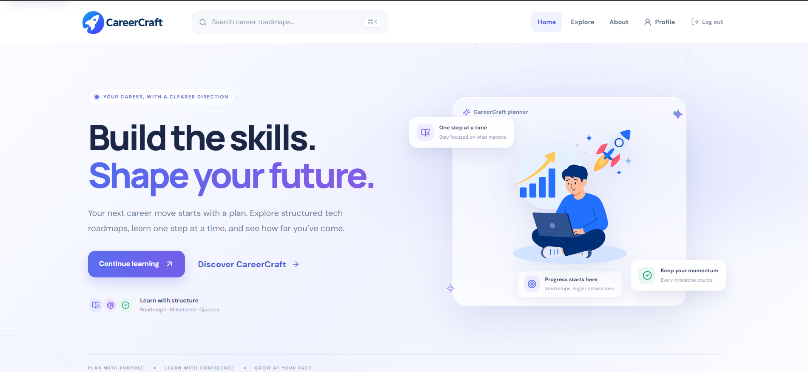
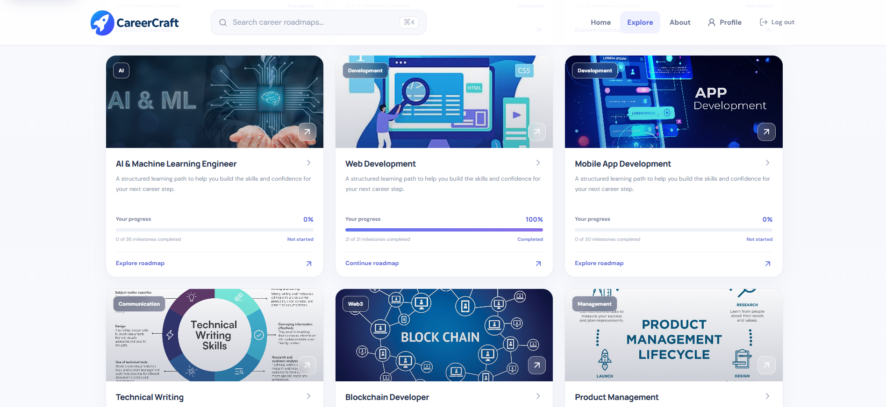
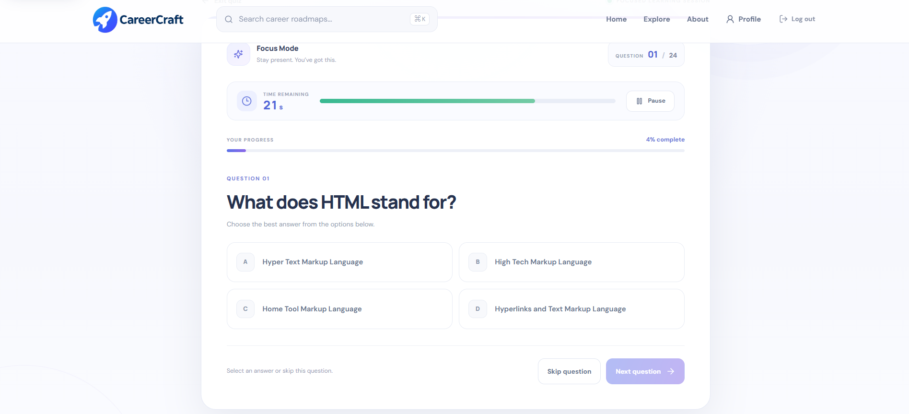

# 🎓 **CareerCraft**

**CareerCraft** is a full-stack MERN platform that helps users **explore career roadmaps**, **track their learning progress**, **take quizzes**, and **gain career insights** — all in one place.

> Built with **React**, **Node.js**, **Express**, **MongoDB**, and **JWT Authentication**, CareerCraft empowers students and professionals to navigate their tech careers efficiently.

---

## 🌟 **Key Features**

- 🔐 **Authentication** — Secure login/signup with JWT and protected routes.  
- 🧭 **Career Roadmaps** — Step-by-step learning paths for various tech careers.
- 📌 **Progress Tracking** — Track your roadmap journey with visual completion bars.
- 🧠 **Quiz Module** — Take topic-wise quizzes with timers, scoring, and result analysis.
- 📈 **Analytics Dashboard** — Visualize time spent, topic strengths, and activity.
- 🔍 **Live Search** — Instantly filter and find roadmaps with animated search.
- 📱 **Responsive Design** — Fully mobile-optimized using **Tailwind CSS**.
- 🔧 **Admin Control** *(coming soon)* — Add/edit roadmap and quiz data dynamically.
- 🔁 **Persistent Progress** — Quiz and step progress saved across sessions.

---

##  **Tech Stack**

| Layer        | Technologies                                     |
|--------------|--------------------------------------------------|
| **Frontend** | React.js (Vite), Tailwind CSS, Recharts          |
| **Backend**  | Node.js, Express.js                              |
| **Database** | MongoDB with Mongoose                            |
| **Auth**     | JWT (JSON Web Tokens)                            |
| **API**      | RESTful Routes using Axios                       |

---

##  **Getting Started**

### 1. Clone the Repository
```bash
git clone https://github.com/abhishek5703/careercraft.git
cd careercraft
```
### 2. Setup Backend
```bash
cd server
npm install
```
### 3. Setup Frontend
```bash
cd ../client
npm install
```
### 4. Environment Variables
```bash
MONGO_URI=your_mongodb_connection_string
JWT_SECRET=your_jwt_secret
PORT=5000
```
### 5. Run the App
Start the backend:
```bash
cd server
npm run dev
```
Start the frontend:
```bash
cd ../client
npm run dev
```
Visit: http://localhost:5173


## 🤖 AI Roadmap Chatbot

CareerCraft now includes an authenticated AI chatbot on roadmap detail pages. The backend supports two zero/low-cost modes:

- **Ollama (recommended for local development):** runs an open model on your machine, so there is no per-request API bill.
- **Gemini Free Tier (recommended for deployment):** use a Google AI Studio API key and keep the backend provider set to `gemini` or use `auto` with `GEMINI_API_KEY` configured. Google currently documents free input/output tokens for eligible Gemini models, subject to the free-tier limits.

### Local setup with Ollama

Install Ollama, then download a small model:

```bash
ollama pull gemma3:4b
```

Start the backend with:

```bash
cd server
npm run dev
```

The default `AI_PROVIDER=auto` tries local Ollama first.

### Deployment setup with Gemini

Create a key in Google AI Studio and configure your deployment environment with:

```env
AI_PROVIDER=gemini
GEMINI_API_KEY=your_key
GEMINI_MODEL=gemini-3.7-flash
```

Do **not** put the Gemini key in the Vite client environment; it must remain server-side.

## 🧪 How to Use

🔐 Login or Signup to access roadmaps and quizzes.

📚 Browse interactive tech career roadmaps.

✅ Click steps to mark as completed and track your progress.

🧠 Take quizzes after completing roadmap sections.

📊 View your quiz scores, topic-wise performance, and progress analytics.

🔎 Use search bar to find roadmaps in real-time.

📱 Enjoy a seamless experience across devices.


## 📸 Demo Screenshots

### 🏠 Homepage Preview  
Landing page with navigation and search bar.  


---

### 🧭 Roadmap Dashboard  
Browse career roadmaps and track your learning visually.  


---

### 🧠 Quiz Module with Timer  
Timed quizzes with scoring and review functionality.  


---

### 📊 Analytics Dashboard  
View your progress, topic performance, and learning stats.  


### 🤝 Contributing
Pull requests are welcome!

To contribute:

1. Fork the repo

2. Create a new branch
```bash
git checkout -b feature-name
```
3. Commit your changes

4. Push to your fork

5. Open a pull request

Open an issue first for significant feature suggestions or changes.

## 📬 Contact

**Developer**: Abhishek Kumar  
📧 **Email**: abhikumar898307@gmail.com  
🌐 **GitHub**: [github.com/abhishek5703](https://github.com/abhishek5703)  
💼 **LinkedIn**: [linkedin.com/in/abhishekkumar8983](https://www.linkedin.com/in/abhishekkumar8983/)


## New Authentication, Profile & Smart Resource Features

CareerCraft keeps its original MongoDB/JWT authentication, roadmaps, progress, quiz history and AI flows while adding Firebase Authentication support alongside them.

### Firebase / Google Sign-In setup
1. Create/open a Firebase project.
2. Enable Authentication > Sign-in method > Email/Password and Google.
3. Add `localhost` and your deployed frontend domain under Firebase Authentication > Settings > Authorized domains.
4. Create a Google Web OAuth client ID and set it as `VITE_GOOGLE_CLIENT_ID`.
5. Set `FIREBASE_WEB_API_KEY`, `FRONTEND_URL`, `JWT_SECRET` and your existing Mongo/AI environment variables on the server.

### Forgot-password email
Password reset email delivery uses Firebase Authentication. The server provisions/link-checks Firebase password accounts so older CareerCraft accounts can be migrated the next time they sign in. Firebase's secure reset flow is used for the email action. CareerCraft also includes `/reset-password` as a custom email-action handler when the Firebase email template is configured to use it.

### Profile management
Users can upload a profile image, edit their display name/photo, remove their photo, and permanently delete their CareerCraft profile. Deleting a profile also removes that user's roadmap progress and quiz-attempt history.

Profile images are resized in the browser and stored with the user document, avoiding reliance on Vercel's ephemeral filesystem.

### Smart Resource Recommendation
Roadmap steps are enriched at response time with curated, topic-aware resources from official documentation, universities, reputable learning platforms and hands-on practice sites. Existing roadmap URLs are retained as a fallback so current content is not lost.
